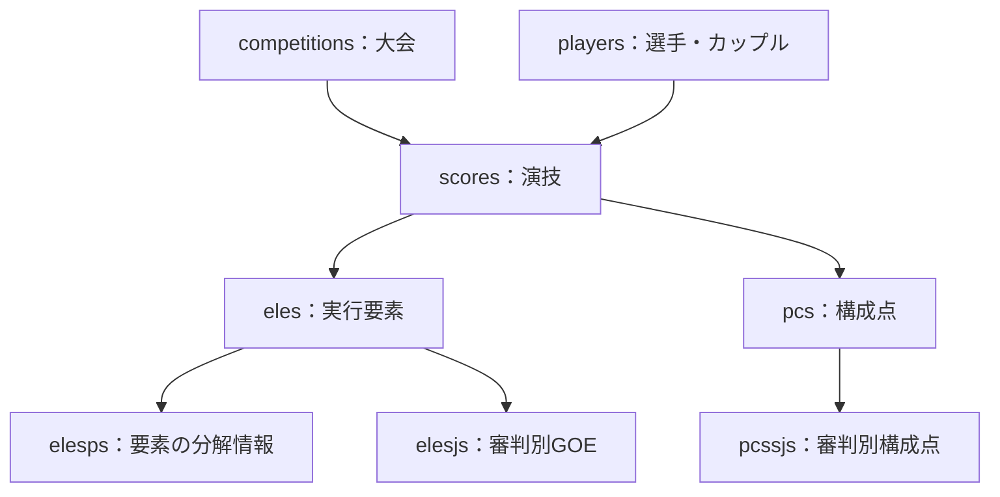

# Figure Skating 内部仕様

作成日：2026-11-17。提供されたweb.zipのソースを読んで整理した静的仕様。
稼働中の本番環境・実DBを調査した結果ではない。APソースの変更は実施していない。
用途・操作はuse.md、デプロイ・運用はmente.mdを参照。

## 1. 構成

Python 3.11以降、Flask、Jinja2、SQLiteを使用する。
サーバーがSQL結果をHTMLに展開し、ブラウザへ返す構成。画面全体をJSON APIで組み立てるSPAではない。
ブラウザ側JavaScriptは幅調整、検索中表示、動画候補切り替え等を担当する。

| ファイル | 責務 |
|---|---|
| app.py | アプリ生成、URL、画面用クエリ、順位集計、入力検証 |
| db.py | 読み取り専用接続、SQL認可、任意SELECTの制限 |
| score_protocol_isu_json.py | 演技と明細の読出し、採点表JSON生成 |
| protocol_search.py | 意図・選手候補の解決、SQL生成・検証・検索キャッシュ |
| search_rules.md | SQL生成時に渡す業務ルール・検索例 |
| ai_json.py | OpenAIへの構造化出力要求 |
| api_client.py | 外部JSON通信、リダイレクト拒否、エラー整形 |
| element_codes.py | 検索用ジャンル判定関数 |
| segments.py | セグメント表示名の統一 |
| player_links.py | ISUプロフィール確認・リンクキャッシュ |
| youtube_search.py | YouTube検索、頻度制御、結果キャッシュ |
| video_matcher.py | タイトル等によるAI候補照合 |
| sql_log.py | 日別SQLログとコピー実行可能な書式 |
| templates/ | Jinja2画面・共通部品 |
| static/panels.js | パネル幅調整 |
| static/search_busy.js | 検索中表示・二重送信抑制 |
| static/videos.js | 動画候補の切り替え |
| cloudrun.py | Cloud Run用WSGIエントリ、ログ・一時DB設定 |
| Dockerfile | Python実行環境とGunicorn起動 |

## 2. 起動と設定

`create_app(db_path, update_db_path=None, youtube_search=False, openai_model=None)`で生成する。
本体DBは起動時に存在確認・絶対パス化。本体と更新DBが同じパスならValueError。
ProtocolSearchは起動時にスキーマ・分類マスタ・search_rules.mdを読み込む。
そのため検索ルールやスキーマ変更時はAPを再起動する。

| CLI引数 | 標準 |
|---|---|
| --db | app.pyと同じディレクトリのfigure.sqlite3 |
| --update-db | 本体DBと同じディレクトリのfig_update.sqlite3 |
| --host / --port | 127.0.0.1 / 5000 |
| --youtube-search / --no-youtube-search | 無効 |
| --openai-model | OPENAI_MODEL、なければgpt-4.1-mini |

直接起動はFlask開発サーバー、debug=False。
Cloud RunではGunicornからcloudrun:appを使用し、FIGURE_DBまたは/app/data/figure.sqlite3を参照する。
更新DBは/tmp/fig_update.sqlite3、SQLログはstderrからCloud Loggingへ出す。
Cloud RunのYOUTUBE_SEARCH_ENABLEDは小文字化した1/true/yesで有効。それ以外は無効。
OKEY・YKEYはサーバー環境変数。ブラウザへキーを返さない。

## 3. URL一覧

| Method | URL | 処理・主な入力 |
|---|---|---|
| GET | / | ツリーと演技検索フォーム |
| GET | /competition/<id>/category/<id> | 大会・種目の集計順位 |
| GET | /score/<id> | 採点表、選手・大会リンク、動画 |
| GET | /player/<id> | 選手の全演技履歴、sort/direction |
| GET | /search | q、sort、direction。AI検索 |
| GET | /xxapijson/score/<id> | 採点表JSON |
| POST | /sql | formのsql。参照専用SQL実行。画面入口は非表示 |
| GET | /guide/<topic> | protocol / elementsのみ |
| GET | /masters/<kind> | elements/players/categories/genres/components/segments |
| GET | /executed-elements | 実行要素条件検索 |
| GET | /static/<path> | CSS以外のJS・画像等の静的ファイルも配信 |

不存在の演技・選手・大会／カテゴリ、未定義guide/master種別は404。
大会種目内で同じ選手に同じセグメントが複数存在すると409。
数値フィルターの不正値は400。最大リクエスト本文は20,000バイト。
AI検索エラー・任意SQLエラーは、通常は画面内に表示するためHTTP状態だけで成否を判定しない。
URLを隠すことはアクセス認証・大量取得対策ではない。利用者認証やIP別レート制限はこのコードにはない。

## 4. 本体データの関係

分類マスタはm_categories、m_genres、m_elements、m_pcomponents、m_segments、m_kinds。
commentはscore_idに動画IDを関連付ける。本体の任意表playerは公式プロフィールリンクの反映先。
players（競技選手本体）とplayer（リンク補助表）は別用途。
実績のマスタ不一致やm_element_id=-1を許容し、検索に必ずm_elementsとの内部結合を要求しない。
本システムではelespsの再分解・修正・マスタID再照合を実施しない。

## 5. 年度、順位、表示単位

ツリーはcompetitionsとscoresを結合し、実績がある大会・種目を表示する。
年度は大会開始日の年から1〜3月なら1を引く。取得不可ならhpのseasonYYZZ、最後にyearへフォールバック。
実行エレメント検索の年度式はstart_d優先・次にyearであり、hpのseasonYYZZは参照しない。この差は現行実装の留意点。

集計順位はplayer_idでまとめ、全セグメントのrank>0、かつセグメント数2以上を完了条件とする。
完了者はtss合計降順、同点同順位（1,1,3方式）。未完了者は後ろへ配置する。
公式最終順位表や公式タイブレーク計算を参照していない。

tss/tes/pcs/減点/基礎点/最終GOE/要素得点/PCS審判値は100倍整数を100で割る。
elesjs.valueは審判のGOE段階評価なので割らない。欠損値は表示上ダッシュ等へ変換する。
セグメント表示はsegments.pyで統一し、DBの登録値は更新しない。

## 6. 採点表JSON

scores.idを起点に、関連選手・大会・分類、eles/elesps/elesjs、pcs/pcssjsを読み出す。
_get_db_protocolは内部ID・警告・親なし明細を含む中間構造を作る。
get_protocolはDB固有ID・分解情報・管理項目を除き、次の構造へ変換する。

| キー | 内容 |
|---|---|
| competition/category/segment/date | 大会・分類・演技日 |
| name/nation/rank/starting_number | 選手情報・順位・開始順 |
| total_segment_score/total_element_score/total_program_component_score | 合計・技術・構成点 |
| deductions | totalとdetails。detailsはnull |
| judge_numbers | 審判番号の昇順配列 |
| elements | number/name/info/base_value/後半フラグ/goe/score |
| elements[].goe | valueは最終GOE点、judgesは審判別段階評価 |
| total_base_value | 総基礎点 |
| program_components | name/factor/score/judges。factorはnull |
| source_pdf | 元PDF URL |

審判配列はjudge_numbersと同じ位置で対応し、欠番はnull、審判記録がなければ空配列。
構成点項目名は登録済みマスタを使用し、年代から再解釈しない。
関連欠損や親なし明細はstderrへ警告。公開JSONには内部警告構造を返さない。
HTML採点表ではPDF URLをhttp/httpsに限定する。JSON経路では同じURLフィルターを通さない。
CLIでもscore_protocol_isu_json.pyから出力可能。既存出力ファイルは上書きしない。

## 7. Text-to-SQL

1. qをtrimし最大500文字に切る。空ならAPIを呼ばない。
2. 同一質問・言語・モデルの成功した生成条件をキャッシュから探す。
3. 未キャッシュならOpenAIで選手名候補と意図を構造化出力する。
4. 名前を単語に分け、players.nameの小文字LIKEで照合。入力候補は最大10、候補選手は最大50。
5. スキーマ、分類マスタ、固定RULES、search_rules.md、選手候補をOpenAIへ渡す。
6. sqlとnoteだけの厳密なJSON形式で回答させる。SQL生成の出力上限は2,000トークン、store=False。
7. 件数は最大20。単一ベスト指定は1。明示した件数は1〜20へ制限する。
8. 指定選手があるときは候補選手の演技に制約する。候補ゼロなら空集合。
9. sort指定は許可済みカラムへ変換し、対象集合をCTEに包んでDBで再取得する。
10. run_selectで実行。返却列がscore_idの1列、値が整数であることを検証し、重複排除・選手制約を再確認。
11. 取得ID順に演技一覧を組み立てる。

キャッシュはプロセス内600秒。最大128エントリに達すると全消去する方式。
キャッシュするのは生成SQL等であり、演技結果そのものは再実行する。並べ替えでも生成条件を再利用する。
noteは350文字まで。自然文の誤解や意味的に不適切なSELECTまではSQL認可だけでは防げない。
現行はRAGやファインチューニングを使用せず、固定説明と例を毎回の入力コンテキストへ含める。

## 8. SQLiteの参照専用制御

open_readonlyはmode=ro、query_only=ON、trusted_schema=OFF、拡張ロード無効で接続する。
SELECT/READ/RECURSIVEと許可リスト内の関数だけauthorizerで許可。search_genreも登録する。
通常画面の固定SQLはパラメーターで入力値を渡し、sortカラム等は固定マップから選ぶ。

run_selectでは追加で以下を適用する。

| 項目 | 制限 |
|---|---|
| 文の先頭 | コメントを除いてSELECTまたはWITH |
| 複数文 | sqlite3.executeで拒否 |
| SQL長 | 16,000文字 |
| 取得件数 | 1〜100、既定100。AI検索は最大20 |
| 実行時間 | 約2秒の期限を1,000命令ごとの進捗コールバックで確認 |
| SQLite値長 | 1,000,000バイト |
| 列数／式の深さ | 各100（setlimit対応環境） |
| セル文字列 | 4,000文字を超える場合切り詰め |
| BLOB | 先頭2,000バイトを16進文字列へ変換 |
| 返却データ量 | 行文字列表現のUTF-8換算で約1MB |

2秒は全HTTP応答時間の上限ではない。固定画面SQLにはrun_selectの進捗期限を適用していない。
SELECT_ONLY等のエラーは更新せず返す。本体参照専用と、更新DBの書き込み権限は分離する。

## 9. マスタ・実行要素検索

名前は最大200文字。LIKEの!/%/_をエスケープし、名前の値はバインドする。
エレメント検索はname/jname/sname、選手検索はname/jname/name1を対象とする。
選手一覧で日本語名を独立表示しなくても、jnameは検索対象に残っている。
エレメントのページ数は100件単位、選手は1ページ最大100件。範囲外ページは丸める。

実行要素検索はcategory/genre/segment/seasonを整数検証する。
base_value/goe/scoreのmin/maxはDecimalで通常点数を受け、有限値・絶対値100000以下・小数第2位までを検証し100倍整数へ変換。
下限>上限、late/illegal/no_countが0/1以外なら400。
101件取得して上限超過を検出し、先頭100件を表示する。
実行要素の名前入力は部分一致であり、%を入力して自由なLIKE式を指定する機能ではない。

search_genreは明確なジャンプ表記を1、スピン表記を2にする。
ジャンプ形状でないのに保存ジャンルが1ならNULL。それ以外の不明分類は保存値を返す。
ChSp等、年代・競技で意味が変わるものを全面的に解決する関数ではない。

## 10. YouTube登録・検索・照合

comment表がある場合はscore_id一致、delflg=0、blackout=0、id昇順の動画を取得。
11文字の[A-Za-z0-9_-]に一致するIDだけ採用し、重複を除いて最大4件。
comment表が存在する限りscores.youtubeにはフォールバックしない。
comment表がない旧DBのみscores.youtubeを使う。

有効な登録がなく自動検索有効なら、選手・大会・演技年・セグメントから検索語を作る。
YouTube search APIはtype=video、videoEmbeddable=true、最大5件。タイトル・チャンネル等だけ取得。
OpenAIはメタデータから最大4件を選び、入力候補以外のIDは採用しない。
映像内容・権利状態・埋め込み成功を保証する判定ではない。

| 更新DB表 | 用途 |
|---|---|
| youtube_search | score_id別の検索語、候補payload、status、確認時刻 |
| youtube_control | 次に検索できる時刻 |
| youtube_matches | モデル・演技・候補から作る署名に対する採用結果 |

検索成功は86,400秒、pendingは60秒、その他エラーは3,600秒キャッシュ。
検索間隔は更新DBを共有する全体で5秒以上。通信失敗時は全体の次回検索を1時間抑制。
検索キャッシュは30日超を削除。AI照合キャッシュは24時間で削除。
BEGIN IMMEDIATEで問い合わせ枠を確保し、外部通信中はDBの書き込みトランザクションを保持しない。
検索またはAI照合失敗時は、未照合の自動候補を表示しない。

## 11. ISU選手リンク

主DBの任意表playerを優先し、更新DBのplayerを次に参照する。
確認済みURLがなければ、個別選手表示時に名前からslugを生成してISUへ照会する。
ホスト・HTTPS・プロフィールパスを検証し、HTTP200に加えて見出しの正規化名一致を確認する。
タイムアウト3秒、HTMLは最大750KB。HTMLは確認にのみ使用し保存・転載しない。
foundは再照会しない。miss等は30日、error/pendingは1日抑制。全体間隔は5秒以上。
一覧ではcached_urlだけを呼び、大量ネットワーク照会しない。
旧players.hpはisuresults.comの/bios/に限定して併記する。
更新DBにはplayerとlookup_controlを作成する。本体へのバッチ反映処理自体は含まない。

## 12. ログ・外部通信・運用留意

ローカルはlogs/sql_YYYYMMDD.logへUTF-8追記し、日付変更後の記録で切り替える。
問い合わせ、生成SQL、実行SQL、件数、エラーをrequest_idで関連付ける。
SQL以外は行コメントにし、SQLは実改行・セミコロン付きで記録する。
生成SQLと実行SQLを両方実行すると2回実行になる。通常は実行SQLだけをコピーする。
search_genreは接続時に登録する独自関数なので、別DBツールでのコピー実行には同じ関数が必要。
ログの日付は環境のローカル日付。圧縮・保存期限による削除は運用側の責務。

外部JSON通信はリダイレクト拒否、応答約2MB上限、既定30秒（YouTube検索12秒）。
サービス名とエラーコードへ整形し、APIキーを含むURLやproviderの応答本文を画面・ログへ出さない。
SQLログには利用者の質問や生成SQLが入るため、保管・公開範囲に注意する。

Cloud Runの更新DBとプロセスキャッシュは永続データではなく、再起動で失われる場合がある。
本体DBはビルド時にCloud Storageから取得してイメージへ含める。バケット更新だけでは稼働データは変わらない。
API上限設定は外部サービス側の制御。AP内には月額費用カウンターやユーザー別日次上限はない。
DBの品質、要素の年代別表記、マスタ不一致、検索の意味的精度は別途検証が必要。
